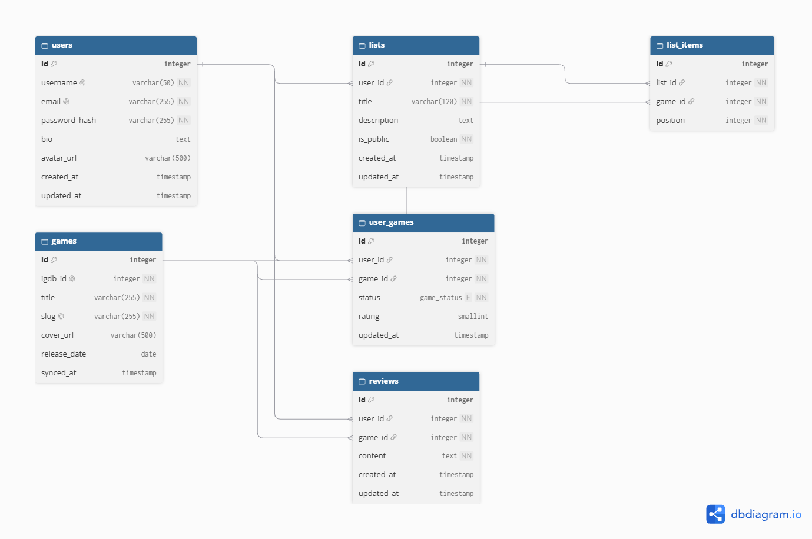

# Game Social

Plataforma social de games, no estilo de um Letterboxd ou Backloggd, só que para jogos. A ideia é marcar o que você está jogando, dar nota, escrever reviews, montar listas e seguir outras pessoas.

Comecei esse projeto para sair dos tutoriais e aprender backend construindo uma coisa grande de verdade. Cada fase exige uma tecnologia nova, e o objetivo é conseguir explicar cada decisão que tomei no caminho. Os dados dos jogos vêm da API da IGDB (Twitch).

O projeto está em desenvolvimento. Por enquanto só a parte do banco de dados está pronta, a API ainda não existe.

## Status

- [x] Fase 0: modelagem do banco, PostgreSQL no Docker e migrations com Alembic
- [ ] Fase 1: API com FastAPI, autenticação com JWT e integração com a IGDB
- [ ] Fase 2: parte social (seguir, feed, curtidas e comentários)
- [ ] Fase 3: Redis com cache-aside, WebSockets, busca e filas de jobs
- [ ] Fase 4: load balancer, CI/CD e deploy na nuvem

## Tecnologias

Em uso: Python, SQLAlchemy 2.0 (async), Alembic, PostgreSQL, Docker e uv.

Planejadas: FastAPI, JWT, Redis, WebSockets, Celery, Nginx e GitHub Actions.

## Banco de dados


Por enquanto são seis tabelas:

- `users`: contas dos usuários
- `games`: cache local dos jogos da IGDB. Guarda o `igdb_id`, o `slug` e o `synced_at`, que diz quando o jogo foi sincronizado pela última vez
- `user_games`: relação do usuário com um jogo, com status (`playing`, `completed`, `dropped` ou `wishlist`) e nota de 1 a 10. Um registro por usuário e jogo
- `reviews`: texto da review. Uma por usuário e jogo
- `lists` e `list_items`: listas personalizadas e os jogos de cada uma, com a posição na lista

Separei status e nota (`user_games`) do texto da review (`reviews`) porque dá para marcar um jogo e dar nota sem escrever nada.

Seguidores, comentários e curtidas entram na Fase 2.

Algumas decisões:

- As chaves estrangeiras usam `ON DELETE CASCADE`, então apagar um usuário apaga também as reviews, listas e jogos marcados dele.
- Datas com fuso horário (`timestamptz`).
- Constraints e índices com nomes padronizados, para o Alembic conseguir alterá-los em migrations futuras.

## Como rodar

Precisa do [uv](https://docs.astral.sh/uv/) e do Docker Desktop instalados.

```bash
git clone https://github.com/Caiozin9/Game_social.git
cd Game_social
uv sync
```

Copie o `.env.example` para `.env` e preencha os valores (no PowerShell: `Copy-Item .env.example .env`). A `SECRET_KEY` pode ser gerada com:

```bash
uv run python -c "import secrets; print(secrets.token_hex(32))"
```

As chaves da IGDB (`IGDB_CLIENT_ID` e `IGDB_CLIENT_SECRET`) só serão usadas a partir da Fase 1.

Depois, suba o banco e aplique as migrations:

```bash
docker compose up -d
uv run alembic upgrade head
```

Ainda não há servidor para rodar, só o banco.

## Estrutura

```
app/
  core/       configuração e conexão com o banco
  models/     tabelas (SQLAlchemy)
  schemas/    validação de entrada e saída (ainda vazia)
  services/   regras de negócio e integração com a IGDB (ainda vazia)
  api/        rotas (ainda vazia)
alembic/      migrations
tests/
docker-compose.yml
```

## Anotações

- Instalar o Docker no Windows deu mais trabalho do que eu esperava. Faltava ativar a plataforma de máquina virtual do Windows, e só habilitar a virtualização na BIOS não bastava.
- O Alembic gera a migration sozinho, mas vale ler o arquivo antes de aplicar. Eu ajustei o `downgrade()` para apagar o tipo `game_status`, que ele não remove por conta própria.